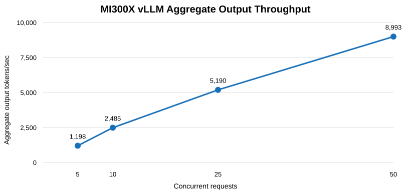

# AMD MI300X Voice AI Agent — Benchmark Report

**Benchmark date:** October 23, 2026  
**Platform:** AMD Instinct MI300X  
**LLM:** Qwen2.5-3B-Instruct with ROCm vLLM  
**ASR:** OpenAI Whisper Small (CPU)  
**TTS:** Kokoro ONNX  
**Backend:** FastAPI  
**Vector database:** Qdrant

## 1. Executive summary

The self-hosted voice agent completed LLM concurrency,
speech recognition, speech synthesis, and end-to-end
speech-to-speech functional benchmarks.

- Peak recorded LLM aggregate throughput: **8,992.70 output tokens/s**
  at 50 concurrent requests.
- Mean Whisper ASR latency: **28.8342 s**.
- Mean Kokoro TTS latency: **1.6398 s**.
- Mean complete voice request latency: **32.5907 s**.
- All nine repeated speech benchmark requests succeeded.

## 2. LLM concurrency results

Five short, warm inference batches were conducted with
128 output tokens per request.

| Concurrency | Successful | Mean TTFT (ms) | Mean latency (ms) | Recorded aggregate output tok/s |
|---:|---:|---:|---:|---:|
| 1 | 5/5 | 14.6 | 349.5 | N/A |
| 5 | 5/5 | 27.8 | 531.1 | 1198.05 |
| 10 | 10/10 | 41.4 | 509.2 | 2484.62 |
| 25 | 25/25 | 77.3 | 606.5 | 5189.73 |
| 50 | 50/50 | 104.3 | 690.1 | 8992.70 |

**Throughput methodology:** The aggregate output throughput
figures are retained from the original run summaries.
The raw per-request CSV files do not store complete batch
wall-clock times, so these totals cannot be independently
reconstructed from the CSVs alone.

## 3. Repeated speech benchmark results

Three sequential requests were run per component, using
a 9.088-second synthetic speech sample as ASR/E2E input.
TTS used a fixed reference text.

| Component | Successful | Mean latency (s) | Minimum (s) | Maximum (s) |
|---|---:|---:|---:|---:|
| ASR | 3/3 | 28.8342 | 28.8114 | 28.8742 |
| TTS | 3/3 | 1.6398 | 1.6132 | 1.6755 |
| E2E | 3/3 | 32.5907 | 32.4552 | 32.8109 |

### Whisper ASR

- Model: Whisper Small
- Execution: CPU, FP32
- Mean real-time factor: **3.1728**
- Mean WER: **0.00%**
- WER is measured on one repeated synthetic English sentence,
  not a representative speech-recognition dataset.

### Kokoro TTS

- Voice: `af_heart`
- Speed: 1.0
- Sample rate: 24 kHz
- Mean real-time factor: **0.1804**
- Output format: WAV via Base64-encoded JSON

### Full voice pipeline

`Audio → Whisper ASR → Qwen LLM → Kokoro TTS → Audio`

- Mean request latency:
  **32.5907 s**
- Success rate: **100% (3/3)**
- A separate initial E2E test took **32.4416 s**
  and generated **21.803 s** of response audio.

## 4. GPU diagnostics

- ROCm 7.2 successfully detected the AMD GPU.
- A separate ROCm PyTorch container completed GPU
  matrix multiplication successfully.
- The production Whisper container used a CUDA PyTorch
  build without GPU passthrough and ran on CPU.
- ROCm-accelerated Whisper was **not deployed or benchmarked**.

## 5. Interpretation and limitations

The system successfully completes speech-to-speech requests,
but current complete-turn latency is not suitable for
low-latency conversational interaction.

Whisper CPU inference is the principal identified bottleneck.

These results are exploratory:
- Only three repeated speech trials per component
- One synthetic ASR input repeated across trials
- No sustained-duration throughput test
- No multi-user voice concurrency benchmark
- No streaming audio first-byte latency measurement
- No voice quality listening-study metrics
- No independently recorded per-stage E2E timings
- No GPU utilization time series linked to every request

The short LLM load tests should not be interpreted as
sustained service capacity or concurrent voice-user capacity.

## 6. Future scope

1. Deploy and benchmark Whisper with ROCm GPU acceleration.
2. Evaluate streaming ASR and incremental TTS.
3. Measure time to first audible response.
4. Add sustained-load and concurrent voice-user testing.
5. Test multilingual speech and noisy audio datasets.
6. Add GPU, CPU, memory, and resource utilization monitoring.
7. Test reliability, recovery, and request error behavior.

## 7. Evidence and reproducibility

Raw evidence is retained under `benchmarks/`:

- `vllm_single_user_baseline.csv`
- `vllm_concurrency_5.csv`
- `vllm_concurrency_10.csv`
- `vllm_concurrency_25.csv`
- `vllm_concurrency_50.csv`
- `speech_repeated_benchmark.csv`
- `speech_benchmark_summary.json`
- `voice_e2e_benchmark.csv`
- `kokoro_test.wav`
- `voice_e2e_output.wav`
- `final_metrics.csv`
- `final_summary.json`

This report preserves completed observations and explicitly
separates future work from measured implementation.
